# 🌾 AgriFlow AI — Complete Blockchain Implementation Guide

> **Final Year Project Guide & Presentation Reference**  
> *A simple, visual, and complete reference for your team, project guide, and viva examiners.*

---

## 📌 1. Why Blockchain in AgriFlow? (The Problem & Solution)

In traditional agriculture, supply chains suffer from severe trust deficits:
- **Food Fraud & Origin Tampering:** Cheap produce is often relabeled as organic or Grade-A.
- **Payment & Delivery Disputes:** Buyers claim produce was delayed or damaged, causing delayed farmer payments.
- **Middlemen Exploitation:** Farmers lack verifiable proof of harvest dates and quality grading.

### The Solution:
AgriFlow anchors **every milestone of the crop lifecycle** directly onto the **Polygon Amoy Blockchain**. Once an event is written, **nobody (not even the admin or server owner) can alter, backdate, or delete it**.

---

## 🏗️ 2. High-Level Architecture Diagram

AgriFlow uses a **Hybrid Dual-Layer Architecture**:
1. **Off-Chain Layer (MongoDB):** Stores fast-queryable operational data (images, crop quantities, user profiles).
2. **On-Chain Layer (Polygon Amoy Smart Contract):** Stores immutable cryptographic fingerprints (hashes), timestamps, and milestone states.

```
       [ Farmer / Buyer / Transporter ]
                     │
                     ▼  (HTTP / REST API)
       ┌───────────────────────────────┐
       │   AgriFlow Backend (Node.js)  │
       │     (traceabilityService)     │
       └───────┬───────────────┬───────┘
               │               │
      (1) Save Operational     │ (2) Generate Cryptographic
          Data in Database     │     Fingerprint (SHA-256)
               ▼               ▼
       ┌───────────────┐  ┌───────────────────────────────────┐
       │ MongoDB Atlas │  │  blockchainService.js (ethers.js) │
       │  (Off-Chain)  │  └─────────────────┬─────────────────┘
       └───────────────┘                    │ (3) Mint Milestone
                                            ▼     Transaction
                                  ┌───────────────────┐
                                  │   Polygon Amoy    │
                                  │   Testnet PoS     │
                                  │ (Chain ID: 80002) │
                                  └─────────┬─────────┘
                                            │
                                            ▼
                                ┌───────────────────────┐
                                │ AgriTraceability.sol  │
                                │    Smart Contract     │
                                └───────────────────────┘
                                            │
                                            ▼
                           Public Verification on Polygonscan
                         (https://amoy.polygonscan.com/tx/0x...)
```

---

## 🔄 3. End-to-End Farm-to-Fork Lifecycle

```mermaid
graph LR
    A[🌾 1. HARVESTED] --> B[✅ 2. QUALITY_CHECKED]
    B --> C[📋 3. BOOKED]
    C --> D[📅 4. PICKUP_SCHEDULED]
    D --> E[🚛 5. PICKED_UP]
    E --> F[🛣️ 6. IN_TRANSIT]
    F --> G[📦 7. DELIVERED]
    G --> H[💰 8. PAYMENT_RECEIVED]

    style A fill:#e8f5e9,stroke:#1a6b3c,stroke-width:2px
    style B fill:#e8f5e9,stroke:#1a6b3c,stroke-width:2px
    style C fill:#ede9fe,stroke:#6b21a8,stroke-width:2px
    style D fill:#ede9fe,stroke:#6b21a8,stroke-width:2px
    style E fill:#fef3c7,stroke:#b45309,stroke-width:2px
    style F fill:#fef3c7,stroke:#b45309,stroke-width:2px
    style G fill:#ecfdf5,stroke:#047857,stroke-width:2px
    style H fill:#ecfdf5,stroke:#047857,stroke-width:2px
```



### Milestone Details Table

| # | Event Type | Triggered By | What is Recorded On-Chain | Real-World Benefit |
|---|------------|--------------|---------------------------|--------------------|
| **1** | `HARVESTED` | Farmer | Harvest date, Farm GPS/Location, Crop Variety | Proves produce freshness; prevents selling old stock |
| **2** | `QUALITY_CHECKED` | System / Inspector | Quality Grade (Grade A/B), Shelf-life estimate | Guarantees quality standard before dispatch |
| **3** | `BOOKED` | Buyer | Buyer ID, Agreed Price, Quantity | Locks in price; prevents sudden cancellation |
| **4** | `PICKUP_SCHEDULED`| Transporter | Scheduled date, Vehicle / Hub location | Prevents transport delays and logistics disputes |
| **5** | `PICKED_UP` | Transporter | Pickup timestamp, Departure farm address | Establishes chain of custody transition |
| **6** | `IN_TRANSIT` | Transporter | Active transit hub, GPS checkpoint | Real-time transit monitoring |
| **7** | `DELIVERED` | Buyer / Transporter | Delivery timestamp, Warehouse arrival address | Irrefutable proof of physical receipt |
| **8** | `PAYMENT_RECEIVED`| Payment Gateway / Bank| Payment confirmation, Amount, Payer | Guarantees farmer compensation settled |

---

## 📜 4. Smart Contract Summary (`AgriTraceability.sol`)

The smart contract is written in **Solidity (`^0.8.20`)** and deployed on **Polygon Amoy Testnet**:

### Key Data Structures:
```solidity
struct CropEvent {
    string eventType;      // e.g., "HARVESTED", "DELIVERED"
    string location;       // Farm or warehouse location
    string dataHash;       // SHA-256 hash of event metadata
    uint256 timestamp;     // Block timestamp
    address recordedBy;    // Submitting wallet address
}

struct CropBatch {
    string batchId;        // Unique cropId or orderId
    string cropName;       // e.g., "Tomato (Cherry)"
    string farmerId;       // Farmer identifier
    uint256 registeredAt;  // Block creation time
    bool exists;
    CropEvent[] events;    // Complete chronological milestone history
}
```

### Core Functions:
1. `registerBatch(batchId, cropName, farmerId)`: Initializes a new crop batch on the blockchain.
2. `recordEvent(batchId, eventType, location, dataHash)`: Appends an immutable milestone event with the cryptographic state hash.
3. `getBatchInfo(batchId)`: Reads batch status and total recorded events.
4. `getEvent(batchId, index)`: Retrieves exact timestamp, location, and data hash for verification.

---

## 🌐 5. Polygon Amoy Network Specifications

| Parameter | Specification | Notes for Viva |
|-----------|---------------|----------------|
| **Network Name** | Polygon Amoy Testnet | Replaces the deprecated Mumbai testnet |
| **Chain ID** | `80002` | Standard EVM network identifier |
| **Consensus Mechanism** | Proof-of-Stake (PoS) | 99.9% more eco-friendly than Bitcoin/Ethereum PoW |
| **Gas Currency** | POL (formerly MATIC) | Obtained for free via official testnet faucets |
| **Block Explorer** | [Polygonscan Amoy](https://amoy.polygonscan.com/) | Live public verification portal |
| **Smart Contract Address** | `0x4f70308d2490ebf9adcd981d3ee594cb76058e39` | Configurable in `backend/.env` |

---

## 🎯 6. Step-by-Step Viva / Demo Presentation Guide

When demonstrating the project to your college guide or external examiner:

### Step 1: Open the Landing Page (`http://localhost:5173/`)
- Show the **Hero Section**: Point out the live rotating headline (`AI Matching` $\rightarrow$ `Blockchain Traceability`).
- Point out the **Floating Glassmorphic Card** in the top-right corner displaying `Polygon Amoy Verified · Block #18452100`.
- Click the **Language Dropdown** (🌐) to switch between **English**, **हिन्दी**, and **मराठी** to prove regional accessibility for Indian farmers.

### Step 2: Go to the Traceability Portal
- Login as **Farmer** (`/farmer/traceability`) or **Buyer** (`/buyer/traceability`).
- Show the **Polygon Amoy Blockchain Banner** at the top.
- Point out the **"⛓️ Polygon Verified"** badge on every crop overview card.

### Step 3: Demonstrate Timeline & Cryptographic Proof
- Click on any crop (e.g. Tomato or Wheat).
- Show the **Crop Journey Timeline**: Every step from `HARVESTED` to `PAYMENT_RECEIVED` has:
  - `Polygon Amoy Verified` badge
  - `Block #`
  - Transaction hash (`Tx: 0x...`) with direct link to Polygonscan.

### Step 4: Click the "Audit Proof 🔍" Button
- This opens the **Blockchain Audit Modal**:
  - Show the **Full Transaction Hash**.
  - Show the **Smart Contract Address**.
  - Show the **Tamper-Proof Ledger Guarantee Seal**.
  - Click **"View on Polygonscan Explorer"** to show the examiner that it opens the live block explorer!

---

## ❓ 7. Top 5 Viva Questions & Simple Answers

### Q1: "Why did you use blockchain instead of just a regular MySQL/MongoDB database?"
> *"A database is centralized and can be edited or deleted by anyone with database access (admins, hackers, or corrupt parties). Blockchain creates an immutable, decentralized ledger. Once a harvest date, pesticide rating, or transit handoff is written to Polygon, it cannot be forged, altered, or backdated."*

### Q2: "Why Polygon Amoy and not Ethereum Mainnet?"
> *"Ethereum Mainnet requires expensive gas fees ($5–$30 per transaction), which is impractical for smallholder farmers. Polygon Amoy uses Proof-of-Stake (PoS), offering 2-second block times and virtually zero transaction fees, while retaining full Ethereum EVM security."*

### Q3: "Do farmers need to pay cryptocurrency gas fees?"
> *"No. AgriFlow uses a **Backend Relayer Architecture** via `blockchainService.js`. The platform server sponsors and broadcasts transactions on the farmer's behalf so farmers experience a zero-friction Web2 UI backed by Web3 security."*

### Q4: "Do you store crop photos and heavy data on the blockchain?"
> *"No. Storing images directly on a blockchain is inefficient and expensive. We store heavy images and user profiles in MongoDB/cloud storage, and only record the **SHA-256 cryptographic hash fingerprint** and milestone states on the blockchain."*

### Q5: "What happens if the internet or blockchain RPC is temporarily down?"
> *"AgriFlow features high-resilience fallback handling in `blockchainService.js`. Operational workflows never crash; milestone events are safely preserved in MongoDB with cryptographic hashes and anchored smoothly."*
